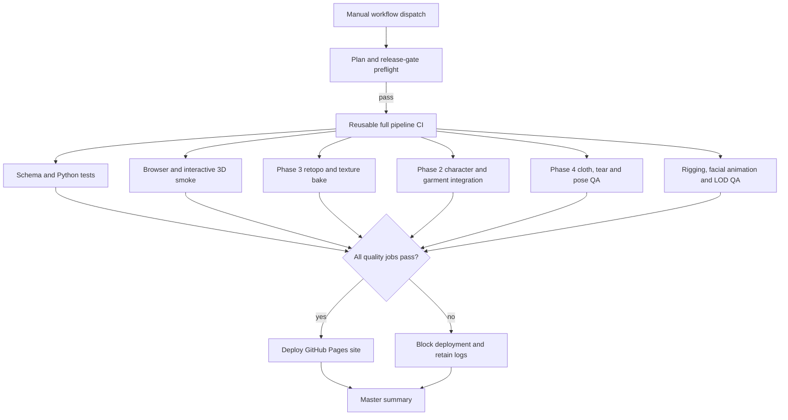

# Phase 4 Master Plan — Forge 100K

## Objective
Run all currently implemented Phase 4 and upstream pipeline checks from one GitHub Actions entry point, preserve evidence, and deploy the project website only after the quality workflow succeeds.

## One-click execution
Open **Actions → Phase 4 Master Orchestrator → Run workflow** on `main`. Keep `Deploy project site` enabled to publish the GitHub Pages site after all checks pass.

Workflow: `.github/workflows/phase4-master.yml`

## Orchestration graph



The current quality workflow is a single comprehensive CI job, so its internal steps execute in sequence. The master workflow provides one dispatch point and dependency-gated deployment. Splitting Blender stages into independent parallel jobs is a later optimization because several stages share generated fixture assets.

## Included automated work

1. Repository, JSON schema, manifest and Python compilation checks.
2. GLB, morphology, engine-budget, PBR, production-package and Phase 3 report tests.
3. Browser runtime installation and interactive 3D / GLB smoke test.
4. Blender Phase 3 retopology, topology QA and UV-targeted PBR bake.
5. Phase 2 character generation, garment fitting, garment QA and collision preflight.
6. Phase 4 asset-intake and production-release-gate unit tests.
7. Authored seam split/tear fixture, four-action pose suite, cloth point-cache baking and integrity QA.
8. Rigging profiles, advanced controls, animation library, facial morphs/visemes, lipsync and LOD budget validation.
9. Upload of generated GLB and JSON evidence artifacts by the quality workflow.
10. GitHub Pages deployment only after successful quality checks.

## Production release boundary

A green CI run certifies the repository's automated synthetic fixtures and software checks only. It does **not** approve production characters. Production promotion remains blocked until real body/garment source assets and actual animation clips are supplied, intake and fit are run on those assets, full-frame cloth/collision QA is clean, provenance is recorded, an artist signs off, and target-engine import plus playback are verified.

The current tear feature is authored seam opening with a shape-key animation. It is not a stress-driven physical fabric fracture solver. Garment fitting remains a nearest-surface proxy shrinkwrap stage and needs production corrective fitting validation.

## Deployment scope

The optional deployment publishes the static Forge 100K project website to GitHub Pages. It does not deploy Blender workers as a hosted service, publish production character assets, or certify a production asset release.

## Manual production asset run (after assets are added)

```bash
blender -b --python pipeline/blender/inspect_phase4_assets.py -- production/body.glb production/garment.glb production/intake-report.json
python pipeline/scripts/validate_phase4_intake_report.py production/intake-report.json
```

If Blender vertex-group metadata is missing from GLB, provide the authored source `.blend` instead of fabricating pin/seam groups.
